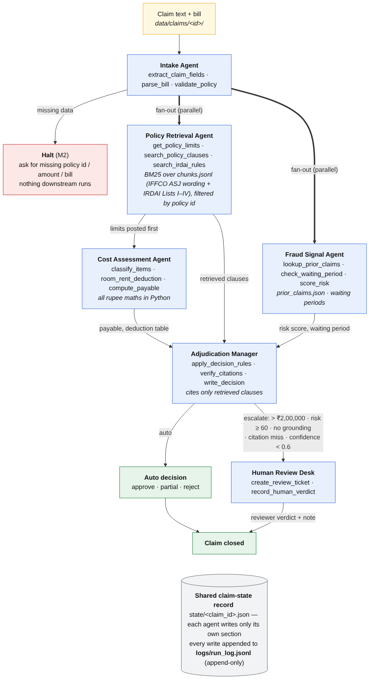

# ClaimLens

> **Educational prototype — not insurance, legal or medical advice.** Synthetic claims only.

ClaimLens reads an Indian health-insurance claim and its hospital bill, checks both against the policy wording and IRDAI rules, and returns **approve, partial approve, reject or escalate**, with the payout and the clause behind every rupee deducted. CSE476 CA2 Project 2, Q1: multi-agent RAG with fan-out / fan-in and human routing.

**Run it:** `pip install -r requirements.txt` · `pytest` · open [`demo.ipynb`](demo.ipynb). Optional LLM: free Groq / NVIDIA keys in `.env` (see `.env.example`); without keys it runs on the rules.

## Agent roster

| Agent | Role | Tools |
| --- | --- | --- |
| Intake | Claim + bill → record; halts if data missing | `extract_claim_fields`, `llm_extract_claim_fields`, `reconcile_fields`, `parse_bill`, `validate_policy` |
| Policy Retrieval | Posts limits, then retrieves clauses | `get_policy_limits`, `search_policy_clauses`, `search_irdai_rules` |
| Fraud Signal | Waiting periods, risk rules, prior claims | `lookup_prior_claims`, `check_waiting_period`, `score_risk` |
| Cost Assessment | Payable, deduction table, over-claim flag | `classify_items`, `room_rent_deduction`, `compute_payable` |
| Adjudication Manager | Fans in, decides, cites, routes to a human | `apply_decision_rules`, `verify_citations`, `write_decision` |
| Human Review Desk | Reviewer's verdict written back; claim closed | `create_review_ticket`, `record_human_verdict` |

## Architecture and why it fits

Intake runs first. **Policy Retrieval and Fraud Signal then run in parallel**: neither needs the other. **Cost waits only for the policy limits**, which Policy posts before it retrieves clauses, so Cost starts early. The **Manager fans in** all three: one place makes the verdict, which keeps it auditable. An escalation goes to a **human** with the recommended payout.

Agents never import each other; they share one record, `state/<claim_id>.json`; each writes only its own section, and every write is appended to `logs/run_log.jsonl`. The graph is a **Microsoft Agent Framework** workflow (`workflow.py`): each agent is an executor, fan-out / fan-in edge groups give the parallel branches, and the only edge message is the claim id.

**Where the LLM sits.** Only Intake uses one, as a *second reading* of the claim by a free open-weight model: Groq `qwen/qwen3.8-27b`, then NVIDIA `nemotron-3.5-lightning-30b-a3b`, then rules only. The rules read first and decide any halt; on a disagreement **the rules win** and the mismatch is logged. The LLM only fills fields the rules couldn't read, never the policy id or an amount. Calls are capped below each free tier (requests and tokens per minute and per day, in `state/llm_usage.json`); the budget left shows in the trace, in `python -m tools.llm_client` and at `GET /llm/usage`.

**All money maths is Python, never the LLM.** Money is `int` rupees, rounded half-up only in `compute_payable`, in the policy's order: IRDAI List I items out → room + boarding + nursing capped at ₹5,000/day (`ASJ-01:4.1.i`), ICU ₹10,000 (`4.1.ii`) → above a cap, all other expenses except medicines cut in proportion (`4.1.1.note2`) → sub-limits (`4.3`, `4.6`) → 5% co-pay (`9.3`) → sum-insured cap. Claimed − Σ cuts = payable, always.

**Fraud score** (weights in `config.yaml`): admitted < 60 days after cover start 35 · claimed ≥ 80% of SI 25 · bill number already used 40 · same-day discharge, not day care 20. **Waiting periods**: 30 days (`6.2.i`), 24 months for listed conditions such as hernia (`6.3.i`), 48 months for joint replacement (`6.3.ii`); accidents exempt.
**Escalate when**: claimed > ₹2,00,000 · fraud ≥ 60 · no clause from the policy's own wording retrieved · a cited clause wasn't retrieved (**citation guard**) · confidence < 0.6 (the weakest cited clause's retrieval score).

## Memory and retrieval

The RAG corpus, `data/corpus/chunks.jsonl`, is the IFFCO Tokio *Arogya Sanjeevani* wording (UIN IFFHLIP20161V011920) split into 202 clauses, plus IRDAI Lists I–IV. Retrieval is BM25 over one policy's chunks (filtered by `policy_id`); the score is the share of the query's IDF weight a clause holds (0–1), so `min_similarity = 0.45` has a fixed meaning and below it nothing returns. Limits come from hand-typed `data/policies.json`, never retrieval, so no payout depends on retrieval luck. `data/prior_claims.json` (36 synthetic claims) is the Fraud agent's memory.

 

## Results — seven scenarios (`tests/test_scenarios.py`, `demo.ipynb`)

| # | Claim | Outcome |
| --- | --- | --- |
| 1 | Appendectomy ₹85,000 | approve ₹79,610 (List I items + 5% co-pay) |
| 2 | Room ₹7,000 + nursing ₹1,000/day | partial ₹48,925 (cap + proportionate 5,000/8,000) |
| 3 | Planned hernia repair, month 6 | reject (`6.3.i`, 24-month wait) |
| 4 | Angioplasty ₹4,50,000 | escalate → reviewer approves ₹4,26,550 → closed |
| 5 | Accident on day 20, reused bill no. | escalate (fraud score 75) |
| 6 | Policy with no wording in the corpus | escalate: "no grounding clause found" |
| 7 | No amount, no bill | intake halts; nothing downstream runs |

Expected values are hand-worked in `data/claims/<id>/expected.json`. 291 offline tests + 4 live API checks (`pytest -m live`); with the real LLM on, all 7 verdicts hold.

## One honest failure

Our first data treated nursing as a separate line, but the PDF's 4.1(i) caps *"Room Rent, Boarding, **Nursing** Expenses"* together at ₹5,000 a day, so scenario 1's clean approval would have tripped a proportionate cut. We re-shaped the bills, pooled room and nursing in the cost tool, and pinned the clause text in a test. The designed failure is scenario 6: with no grounding clause, the Manager **refuses to decide** and escalates.
